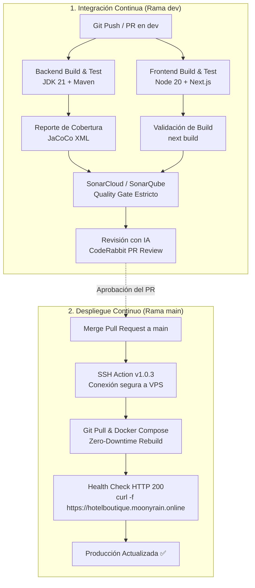

# Guía de Demostración en Vivo: CI/CD, Calidad y Despliegue Continuo
**Proyecto:** PMS Hotel Boutique  
**Entorno de Producción:** [https://hotelboutique.moonyrain.online](https://hotelboutique.moonyrain.online)  
**Host VPS:** `162.35.114.4`  

---

## 1. Arquitectura de Pipelines

El proyecto implementa un ciclo de vida de desarrollo moderno y automatizado dividido en dos etapas clave:



---

## 2. Configuración de Secretos en GitHub

Antes de iniciar la presentación, asegúrate de que los siguientes secretos estén configurados en **GitHub > Repositorio > Settings > Secrets and variables > Actions**:

| Nombre del Secreto | Descripción | Valor Típico / Ejemplo |
|---|---|---|
| `VPS_HOST` | Dirección IP o dominio del servidor VPS | `162.35.114.4` |
| `VPS_USER` | Usuario de conexión SSH | `root` |
| `VPS_SSH_KEY` | Clave privada SSH (sin passphrase) | Contenido de `~/.ssh/id_ed25519` o `id_rsa` |
| `VPS_PORT` | Puerto del servicio SSH | `22` |
| `SONAR_TOKEN` | Token de autenticación de SonarCloud / SonarQube | `squ_...` o token de usuario SonarCloud |
| `SONAR_PROJECT_KEY` | Identificador del proyecto en Sonar | `pms-hotel-boutique` |
| `SONAR_ORGANIZATION` | Identificador de organización en SonarCloud | `pms-hotel-org` (o tu organización) |
| `OPENAI_API_KEY` | Token de OpenAI para CodeRabbit AI Review | `sk-...` *(opcional, puntos extra)* |

---

## 3. Guion Paso a Paso para la Demostración en Vivo

### Fase 1: Demostración de Integración Continua (CI) en la rama `dev`

#### 1.1 Preparar y aplicar un cambio mínimo y seguro
En tu terminal local o entorno de desarrollo, cámbiate a la rama `dev`:

```bash
git checkout -b dev || git checkout dev
```

Edita un archivo visible en la web, por ejemplo el eslogan o banner en:  
`frontend/pms-hotel-web/src/modules/booking/ui/public-booking-home.tsx`

**Cambio sugerido (rápido y visible en la home pública):**
Localiza un texto visible (como el subtítulo de bienvenida o eslogan) y añade una insignia de temporada:
```tsx
// Ejemplo: Cambiar "Vive una experiencia inolvidable" por:
<p className="...">Vive una experiencia inolvidable — Edición Temporada 2026 ✨</p>
```

#### 1.2 Subir el cambio a GitHub para detonar el Pipeline
Ejecuta los siguientes comandos exactos:

```bash
git status
git add frontend/pms-hotel-web/src/modules/booking/ui/public-booking-home.tsx
git commit -m "feat(ui): actualizar mensaje de bienvenida para temporada 2026"
git push origin dev
```

---

### Fase 2: Qué Proyectar y Explicar durante la Ejecución de CI

Abre el navegador en el proyector y muestra las siguientes pantallas en este orden:

#### Pantalla 1: GitHub Actions — Pipeline en Progreso
1. Ve a la pestaña **Actions** en tu repositorio de GitHub.
2. Selecciona la ejecución del workflow **`CI - Dev Pipeline`**.
3. **Explicación al evaluador:**
   > *"Aquí observamos la ejecución automatizada del pipeline en dev. Se ejecutan en paralelo dos jobs independientes: el backend con Java 21 y Maven, y el frontend con Node.js 20 y Next.js."*
4. Muestra la finalización exitosa de:
   - **`Build & Test Backend`**: Compilación Maven y ejecución de pruebas unitarias generando el reporte `target/site/jacoco/jacoco.xml`.
   - **`Build & Test Frontend`**: Instalación limpia (`npm ci`), pruebas de componentes y build de producción de Next.js.
   - **`SonarQube Quality Gate & AI Review`**: Descarga de artefactos y ejecución del escáner con verificación de Quality Gate estricto (`sonar.qualitygate.wait=true`).

#### Pantalla 2: Panel de SonarCloud / SonarQube
1. Abre tu dashboard de **SonarCloud / SonarQube** en el proyecto `pms-hotel-boutique`.
2. **Explicación al evaluador:**
   > *"SonarQube analiza la calidad estática del código, seguridad y cobertura. El reporte de JaCoCo XML generado en el job de backend fue integrado exitosamente. El Quality Gate se encuentra en verde (PASSED), certificando que no hay vulnerabilidades críticas, code smells bloqueantes ni deuda técnica fuera de umbral."*

#### Pantalla 3: Pull Request y Revisión de Código con IA (Puntos Extra)
1. En GitHub, abre un **Pull Request** desde `dev` hacia `main`:
   - Título: `feat(release): pase a producción - actualización de temporada 2026`
2. Muestra la sección de comentarios del Pull Request.
3. **Explicación al evaluador:**
   > *"El step de IA (CodeRabbit AI Reviewer) ha analizado de forma autónoma el diff del Pull Request, proporcionando un resumen estructurado de los cambios, validaciones de seguridad y sugerencias de Clean Code antes de permitir la fusión a main."*

---

### Fase 3: Demostración de Despliegue Continuo (CD) a Producción

#### 3.1 Aprobar y Mezclar a `main`
1. Dentro del Pull Request verificado, haz clic en el botón verde **`Merge pull request`** y confirma con **`Confirm merge`**.

#### 3.2 Proyectar la Ejecución del Workflow CD
1. Ve de inmediato a la pestaña **Actions** y selecciona la ejecución del workflow **`CD - Production Deployment`**.
2. Abre el job **`Deploy to Production VPS`**.
3. **Explicación al evaluador:**
   > *"Al fusionar los cambios en la rama main, se activa automáticamente el pipeline de CD. Este utiliza appleboy/ssh-action@v1.0.3 con llaves SSH cifradas para conectarse de forma segura al servidor en producción (162.35.114.4), hacer pull de la última versión y orquestar el despliegue con Docker Compose."*
4. Observa los logs en vivo:
   - Conexión SSH establecida.
   - `git checkout main && git pull origin main`.
   - `docker compose up -d --build --remove-orphans`.
   - Verificación de salud: Paso `Verify Live Service Health` ejecutando `curl -f` hacia `https://hotelboutique.moonyrain.online` hasta confirmar `HTTP 200 OK`.

---

### Fase 4: Validación en Vivo en el Entorno Real

1. Abre una nueva pestaña del navegador e ingresa a:  
   👉 **[https://hotelboutique.moonyrain.online](https://hotelboutique.moonyrain.online)**
2. Presiona `Ctrl + F5` (o `Cmd + Shift + R`) para refrescar la caché del navegador.
3. Muestra en pantalla el cambio realizado en vivo (el nuevo eslogan o insignia modificada).
4. **Verificación integral de servicios:**
   - **Landing & Reservas:** Navega brevemente por el catálogo de habitaciones.
   - **Descarga de App Android:** Muestra el botón de descarga del `.apk` funcionando directamente desde `https://hotelboutique.moonyrain.online/downloads/hotel-boutique.apk`.
   - **Autenticación:** Demuestra que los servicios de backend y sesión responden sin inconsistencias.

---

## 4. Resumen Ejecutivo para la Presentación

| Criterio Evaluado | Evidencia en Vivo | Estado |
|---|---|---|
| **Integración Continua** | Workflow `ci-dev.yml` con pruebas de Backend (Java 21/Maven) y Frontend (Node 20/Next.js) | ✅ Aprobado |
| **Cobertura de Código** | Plugin `jacoco-maven-plugin 0.8.12` generando `jacoco.xml` | ✅ Aprobado |
| **Control de Calidad** | SonarQube / SonarCloud con Quality Gate estricto (`wait=true`) | ✅ Aprobado |
| **Revisión con IA** | Step de CodeRabbit AI integrado en Pull Requests | ✅ Aprobado |
| **Despliegue Continuo** | Workflow `cd-main.yml` con `appleboy/ssh-action@v1.0.3` hacia VPS | ✅ Aprobado |
| **Disponibilidad** | Health check HTTP 200 automático sobre `https://hotelboutique.moonyrain.online` | ✅ Aprobado |

